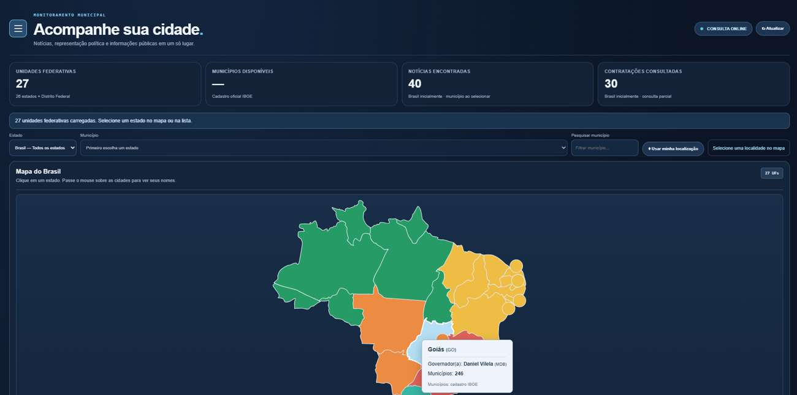

# Município360 — Acompanhe sua cidade

**Notícias, representação política e informações públicas em um só lugar.**

**Acesse o portal:** [Município360](https://nexcode.inf.br/municipio360/)

## Sobre o projeto

O Município360 reúne informações públicas de interesse do cidadão em uma interface que permite explorar o Brasil, os estados e os municípios. O objetivo é facilitar a consulta de dados e notícias, com indicação das fontes e links para conferência das informações.

## Funcionalidades

- **Mapa interativo do Brasil:** seleção de unidade federativa e navegação pelos municípios.
- **Representação política:** informações disponibilizadas pelas fontes oficiais, respeitando eventuais lacunas de atualização.
- **Notícias:** conteúdo e referências provenientes de fontes externas; disponibilidade e pré-visualizações podem variar.
- **Licitações e contratações:** consulta a dados públicos, incluindo o PNCP quando disponível.
- **Seleção de município:** códigos e localidades oficiais do IBGE.
- **Layout responsivo:** uso em computadores e dispositivos móveis.

> **Nota:** fontes externas podem sofrer indisponibilidade, atrasos ou mudanças. Ausência de dados não significa ausência de acontecimentos ou registros.

## Instalação VPS

Faça backup da pasta atual e substitua os arquivos da pasta `municipio360` pela versão do ZIP. Não sobrescreva nem remova `/home/nexcode/ssl-municipio360/ibge-ca-bundle.pem`, pois o `api/common.php` continua a usá-lo. PHP 8.2 com extensões cURL e mbstring. Sem MySQL ou Python.

## Seleção de município

- **IBGE**: cidades e códigos oficiais.
- **TSE**: o endpoint de representantes da v1.7 continua consultando o DivulgaCandContas diretamente. Quando a API não retornar situação de eleito de modo verificável, deixa nomes vazios. *Eleitos de 2024 não equivalem necessariamente a ocupantes em 2026*. Fotos somente quando vier URL oficial.
- **SICONFI/Tesouro**: `api/financas.php?id=5200050&ano=2025` consulta o demonstrativo DCA anual da cidade. Mostra lançamentos brutos (amostra), não soma valores contábeis distintos. Pode haver indisponibilidade ou exercício ainda não publicado. A exibição no portal pode estar temporariamente desativada.
- **PNCP**: licitações permanecem disponíveis.
- **Notícias e contexto social**: `api/social.php?id=5200050` e `?pessoa=...` pesquisam matérias indexadas no GDELT e oferecem links de busca do X, Reddit, YouTube, Instagram e Facebook. **Não extrai publicações privadas, não mede engajamento social e não inventa contagens.** As plataformas sociais exigem APIs/autorização para extração direta.

## Diagnósticos

Teste `/api/localidades.php?tipo=estados`, `/api/representantes.php?id=...`, `/api/financas.php?id=...`, `/api/social.php?id=...`. APIs podem estar indisponíveis independentemente do portal.

## Segurança

Requisições HTTPS com verificação ativa e URLs externas fixas. Cache JSON temporário em `cache/` protegido por `.htaccess`; para Nginx, bloqueie acesso público a `/cache` e `/data`. Nenhuma credencial externa requerida.

## Resiliência de notícias

Quando o GDELT não responde, o módulo social, as notícias locais e o feed nacional tentam Google Notícias RSS. Isso não equivale a acesso direto a redes sociais. O arquivo privado `/home/nexcode/ssl-municipio360/ibge-ca-bundle.pem` permanece configurado em `api/common.php`; preservá-lo no servidor.

### Integração de publicações sociais (YouTube)

O endpoint `api/redes_cidade.php?id=<codigo-IBGE>` usa a **YouTube Data API v3**, somente quando a variável de ambiente `MUNICIPIO360_YOUTUBE_API_KEY` estiver configurada no PHP/Apache/FPM. Configure essa variável no servidor, sem inserir a chave no repositório ou no JavaScript. Habilite a YouTube Data API v3 no Google Cloud e restrinja a chave à API. Após configurar a variável, reinicie o serviço PHP-FPM se necessário. A busca usa até 20 vídeos públicos publicados nos últimos 30 dias e cache de 6 horas.

Sem chave, a seção apresenta status indisponível e **não atribui score social**. YouTube não representa todas as redes, nem sentimento dos moradores. Para Reddit é necessário OAuth autorizado; Instagram/Facebook exigem permissões compatíveis com as APIs oficiais. Não misture menções em notícias indexadas com posts nativos de redes sociais.
